# 🛰️ AstroVital — Monitoreo de salud para astronautas

Aplicación web en **Python · Flask · SQLite** desarrollada como solución al reto
**«Create Health Monitoring Software for Astronauts on Space Missions»** del
**NASA Space Apps Challenge 2026** (tema *The Next Frontier*).

- **Aplicación desplegada (Render):** _pendiente: agregar el enlace_
- **Reto oficial:** https://www.spaceappschallenge.org/2026/challenges/create-health-monitoring-software-for-astronauts-on-space-missions/

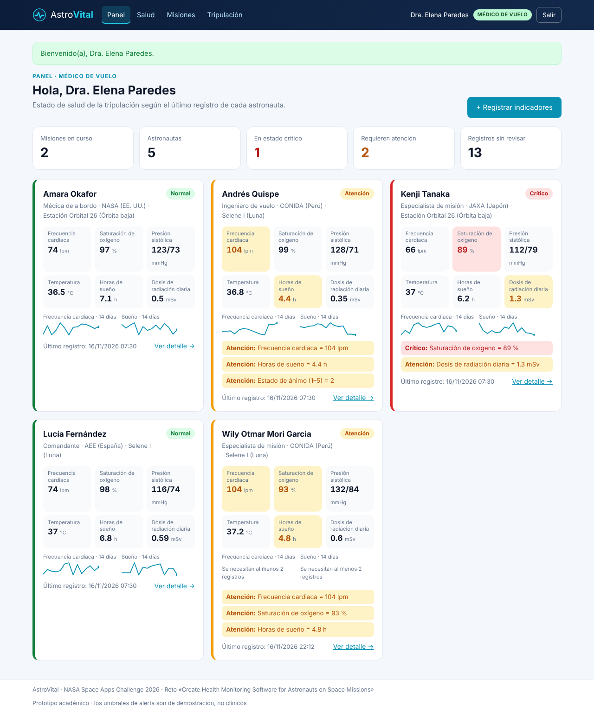

---

## 1. El reto y la solución

**Reto.** El reto pide crear software que ayude a los astronautas a llevar el control de sus indicadores
de salud y a responder a los cambios durante misiones largas (nivel intermedio).

**Problema.** En una misión larga, lejos de la Tierra, la tripulación depende de detectar a tiempo
señales de alerta: frecuencia cardiaca alta, baja saturación de oxígeno, poco sueño o una dosis
de radiación elevada. Si estos datos se anotan en papel o en hojas sueltas, cuesta ver la tendencia
y el médico de vuelo puede enterarse tarde.

**Solución: AstroVital.**
1. Cada astronauta registra a diario **8 indicadores**: frecuencia cardiaca, presión arterial,
   SpO₂, temperatura, horas de sueño, dosis de radiación, estado de ánimo y síntomas.
2. El sistema **evalúa cada valor** contra rangos de referencia y clasifica el registro como
   **Normal**, **Atención** o **Crítico**.
3. El **médico de vuelo** ve en un panel el estado de toda la tripulación, filtra los registros
   sin revisar, consulta la tendencia de 14 días y deja una **nota médica** con la respuesta.
4. El **administrador** gestiona misiones, tripulación, usuarios y roles.

> Los umbrales de alerta son valores de **demostración** del prototipo, no criterios clínicos.
> En una misión real los define el equipo médico.

---

## 2. Módulos

| Módulo | Ruta | Qué hace |
|---|---|---|
| Usuarios | `/registro`, `/login`, `/logout`, `/usuarios/` | Registro, inicio y cierre de sesión, roles y activación de cuentas |
| Panel | `/panel/` | Estado de salud de la tripulación, alertas y tendencias |
| Salud | `/salud/` | CRUD de registros de indicadores y revisión médica |
| Misiones | `/misiones/` | CRUD de misiones (Órbita baja, Luna, Marte, Espacio profundo) |
| Tripulación | `/astronautas/` | CRUD de astronautas y su misión asignada |

El código está organizado en **blueprints** de Flask, uno por módulo (`astrovital/*.py`).

### Roles y permisos

| Acción | Astronauta | Médico de vuelo | Administrador |
|---|:-:|:-:|:-:|
| Registrar y editar sus propios indicadores | ✅ | ✅ (de cualquiera) | ✅ |
| Ver registros de otros astronautas | ❌ (HTTP 403) | ✅ | ✅ |
| Revisar registros y escribir la nota médica | ❌ | ✅ | ❌ |
| Consultar la tripulación | ❌ | ✅ | ✅ |
| Crear, editar o eliminar misiones y astronautas | ❌ | ❌ | ✅ |
| Asignar roles y desactivar cuentas | ❌ | ❌ | ✅ |

Un astronauta ya no puede editar un registro después de que el médico lo revisa.

### Base de datos (SQLite)

`usuario` · `mision` · `astronauta` · `registro_salud`. Las contraseñas se guardan con
`generate_password_hash`. Las tablas tienen restricciones `CHECK` y claves foráneas, y al eliminar
un astronauta se eliminan sus registros (`ON DELETE CASCADE`).

---

## 3. Capturas

| | |
|---|---|
| **Inicio de sesión**<br>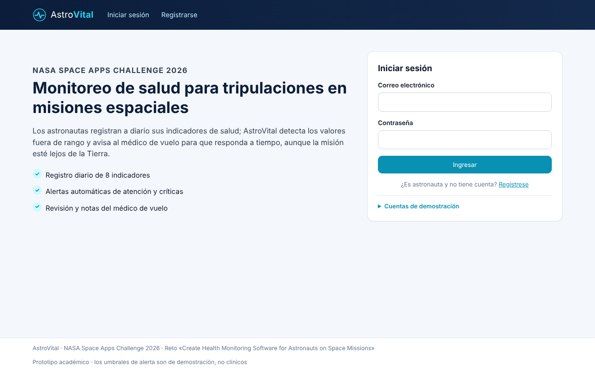 | **Registro de astronauta**<br>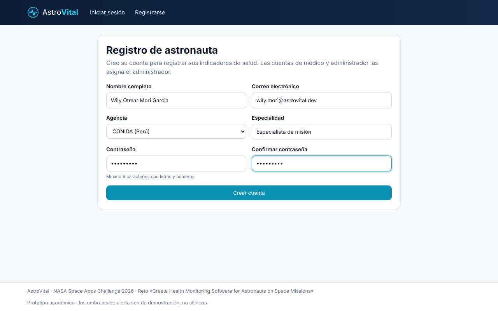 |
| **Registro de indicadores**<br>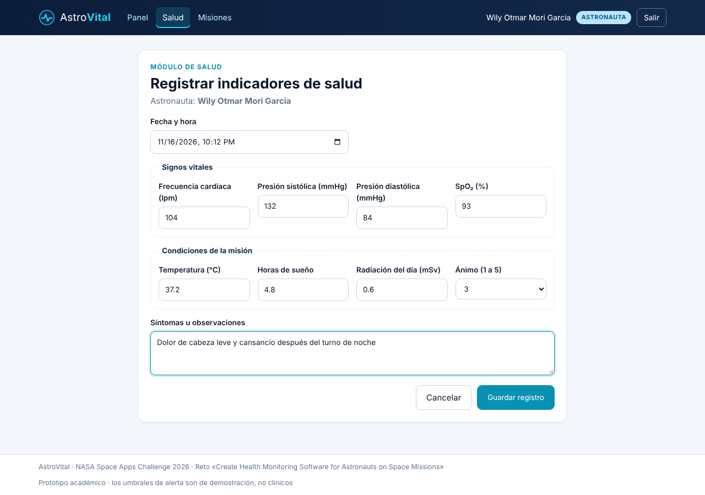 | **Alerta automática**<br>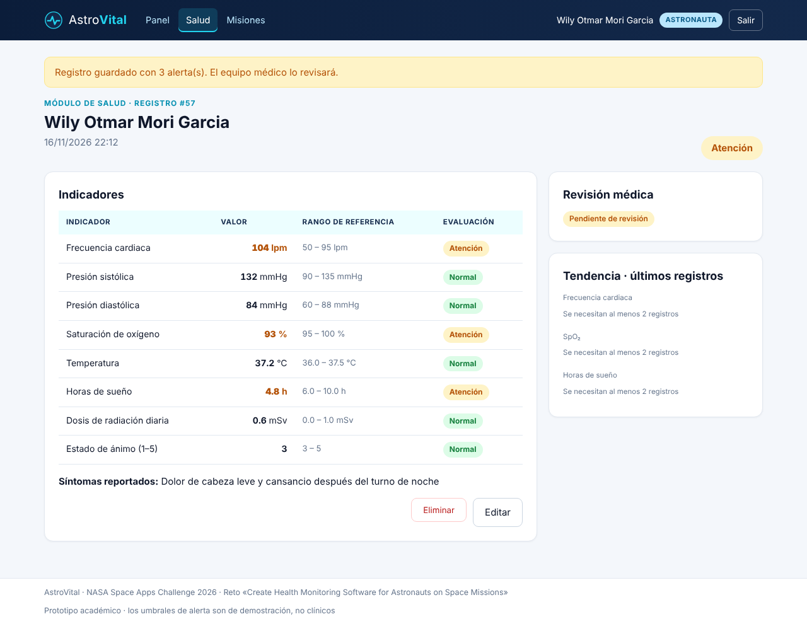 |
| **Registros de la tripulación (médico)**<br>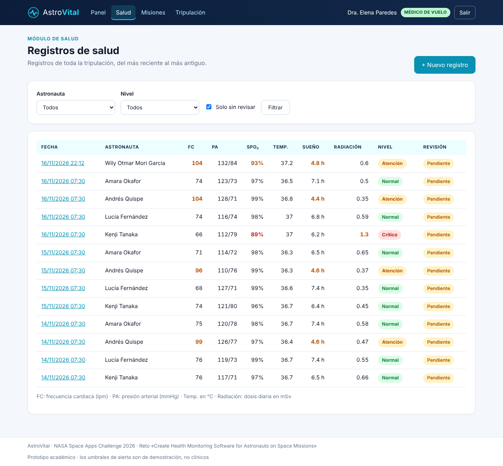 | **Revisión médica**<br>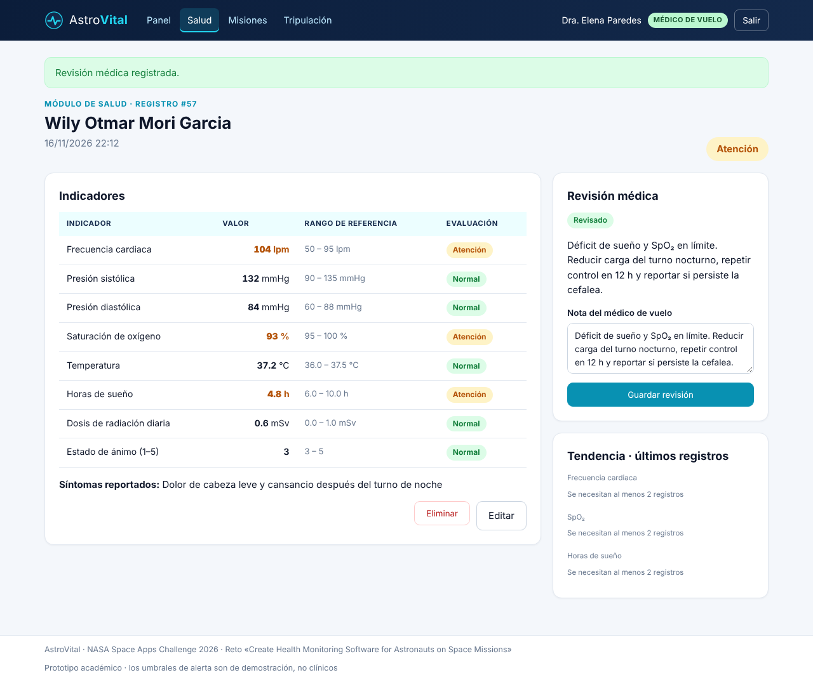 |
| **Misiones (CRUD)**<br>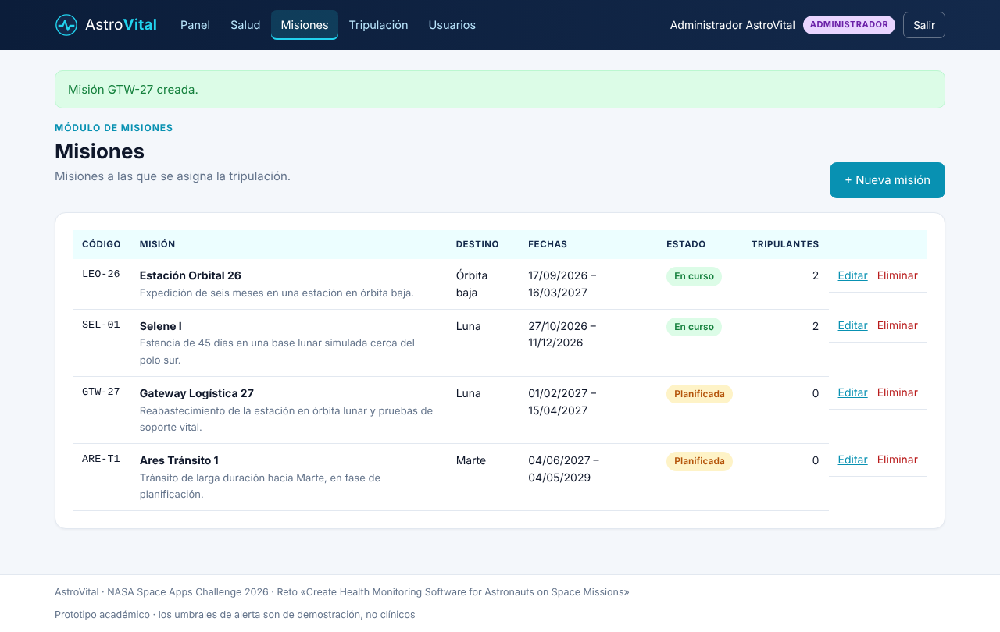 | **Usuarios y roles (admin)**<br>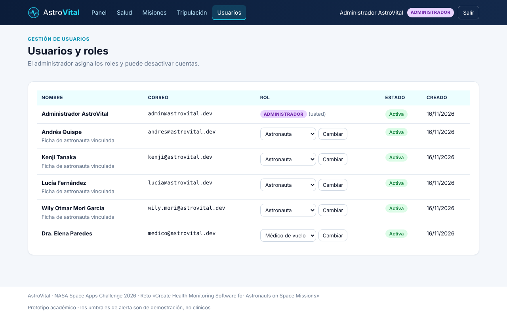 |
| **Acceso denegado a un astronauta**<br>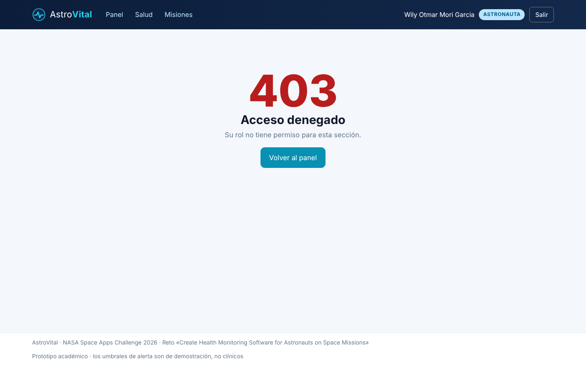 | **Pruebas automatizadas**<br>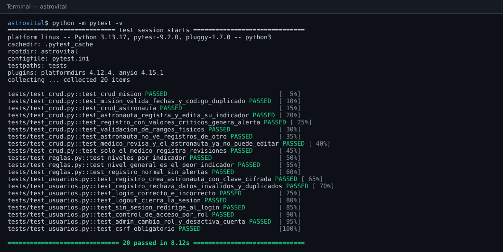 |

---

## 4. Ejecutar en local

```bash
git clone https://github.com/<tu-usuario>/astrovital.git
cd astrovital
pip install -r requirements.txt
python app.py
```

Abrir http://127.0.0.1:5000. La base `instance/astrovital.db` se crea sola, con datos de ejemplo.

### Cuentas de demostración

| Rol | Correo | Contraseña |
|---|---|---|
| Administrador | `admin@astrovital.dev` | `Admin2026` |
| Médico de vuelo | `medico@astrovital.dev` | `Medico2026` |
| Astronauta | `andres@astrovital.dev` | `Astro2026` |

Las personas y misiones de los datos de ejemplo son ficticias.

---

## 5. Pruebas automatizadas

```bash
pip install -r requirements-dev.txt
python -m pytest -v
```

Las **20 pruebas** cubren:

- **Usuarios:** registro con clave cifrada, login correcto e incorrecto, logout, redirección sin sesión, control de acceso por rol, cambio de rol, desactivación de cuentas y CSRF.
- **CRUD:** crear, leer, actualizar y eliminar misiones, astronautas y registros de salud.
- **Validaciones:** rangos físicos de los indicadores, fechas y códigos duplicados.
- **Reglas de alerta:** niveles por indicador y nivel general del registro.
- **Privacidad:** un astronauta no puede ver los registros de otro.

---

## 6. Despliegue en Render

El repositorio incluye `render.yaml`:

1. En [render.com](https://render.com), elegir **New → Blueprint** y conectar este repositorio.
2. Render instala `requirements.txt` y arranca `gunicorn app:app`. La variable `SECRET_KEY` se genera sola.
3. Al terminar, la aplicación queda en `https://astrovital-xxxx.onrender.com`.

> En el plan gratuito de Render el disco es temporal: la base SQLite vuelve a los datos de ejemplo
> cuando el servicio se reinicia o se vuelve a desplegar. Para conservar datos se puede añadir un disco persistente
> y apuntar la variable `DATABASE_PATH` a él.

---

## 7. Estructura

```
astrovital/
├── app.py                 # Punto de entrada (local y gunicorn)
├── render.yaml            # Configuración de Render
├── requirements.txt
├── astrovital/
│   ├── __init__.py        # create_app, CSRF, errores
│   ├── db.py              # Esquema SQLite y datos de ejemplo
│   ├── salud_reglas.py    # Umbrales y evaluación de alertas
│   ├── auth.py            # Registro, login, logout, decoradores de rol
│   ├── panel.py · salud.py · misiones.py · astronautas.py · usuarios.py
│   ├── templates/         # Vistas Jinja2 por módulo
│   └── static/css/
├── tests/                 # Pruebas con pytest
└── docs/capturas/
```

**Tecnologías:** Python 3 · Flask · SQLite · Jinja2 · Werkzeug · pytest · gunicorn · Render
